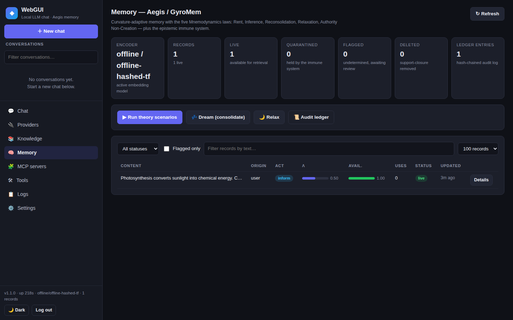
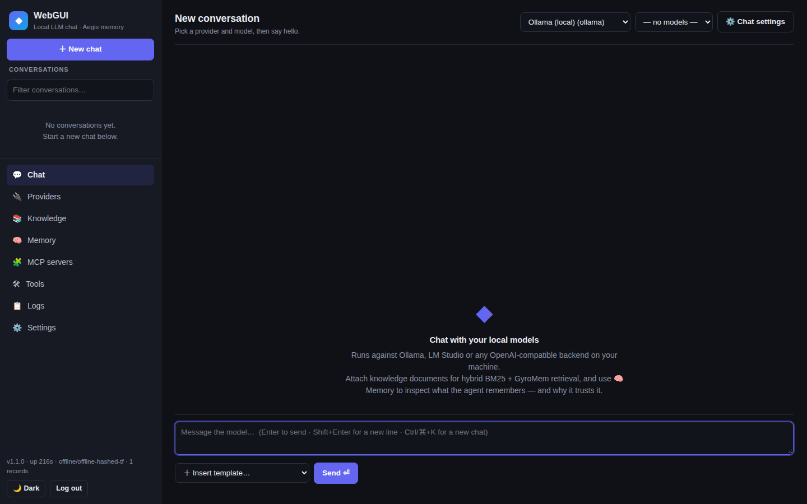

# WebGUI — local LLM chat with Aegis Memory

**Local-first chat for your own models, with a memory layer that decides
what gets remembered — and whether to trust it.**

Most agent-memory systems remember everything your agents do. **Aegis
decides what gets remembered and whether to trust it.** WebGUI is the
reference application for that idea: a zero-dependency Node.js chat UI for
Ollama / LM Studio / any OpenAI-compatible backend, whose knowledge base
runs on **Aegis Memory** — a persistent memory layer built from two
companion theory papers.

> **Honest status:** Aegis is a *theory with a working reference
> implementation*, not a benchmarked product. The papers state five
> predictions with kill criteria; the code implements the mechanisms and
> ships five runnable scenarios that demonstrate them. Nothing here claims
> a result the papers don't. See [Limits](#limits) and
> [scenarios-report.md](scenarios-report.md).

## What Aegis Memory does differently

| Ordinary RAG / agent memory | Aegis |
|---|---|
| Euclidean embeddings + cosine similarity | Memories live on a **mixed-curvature product manifold** (hyperbolic × spherical × Euclidean); retrieval is **geodesic distance**, and radial position encodes abstraction |
| Retrieval is a database lookup | Retrieval **rewires the store**: memories move toward useful queries (geodesic transport) and their precision updates by measured outcome |
| Forgetting = deletion | Forgetting is **reversible drift** (availability decay); deletion is a separate, **measured** operation with a residual-recovery rate and a certificate |
| Anything retrieved can authorize anything | Every record carries an **authority pair** (origin, act class). A derived record can never exceed its least-trusted source — **authority non-creation** — enforced by an **act gate** and a read-time **epistemic immune system** (pass / undetermined / quarantine) |
| Write-time content filters | **Formation + read-time defense**: rent-gated admission, provenance-bound authority, challenge probes, hash-chained audit ledger |

The five laws (from *Five Postulates for Persistent Agentic Memory*):
**Rent** (admission is a decision) · **Inference** (retrieval is read-time
scoring; authority is bound at write time, frozen) · **Reconsolidation**
(λ ← clip(λ + η(1 − 2·surprise))) · **Relaxation** (availability decay,
restored on re-evidence) · **Authority Non-Creation** (Auth(m′) ≤
min Auth(mᵢ)).

## The five scenarios — run them yourself

```bash
npm run scenarios
# or: node server/scenarios.js
```

| Scenario | What it proves |
|---|---|
| 1. Geodesic retrieval beats cosine | A lexically nearer but wrong-abstraction record wins on cosine; geodesic distance ranks the right memory first |
| 2. Reconsolidation: success sharpens memory | λ rises 0.50 → 0.80 over three successes, falls on failures; transport shortens query distance |
| 3. Relaxation is reversible forgetting | Availability decays below the retrieval floor (withheld, content retained), then restores on re-evidence — and deletion is shown to be a different thing |
| 4. Authority non-creation stops a laundering attack | A consolidation that upgrades an untrusted record into a user-authorized one is quarantined at read time, refused by the act gate, and never reaches the model — while legitimate records keep working |
| 5. Deletion is measured, not asserted | Support-closure removal + fixed-reader residual probe + self-issued certificate; an independent re-probe reproduces the reported rate exactly |

Latest checked-in result: **5/5 scenarios passed** — see
[scenarios-report.md](scenarios-report.md) (generated 2026-11-11, offline
hashed-TF encoder). The scenarios are the demonstration, not the papers'
Phase 2 evaluations (LoCoMo/LongMemEval, frozen harnesses, ≥3 replicates)
— the report says so on its face.

## What it looks like

The memory console — every record with its λ precision, availability,
authority pair, and status, plus the scenario runner:



Chat — streaming, tools, knowledge attachment, provider/model selectors:



## Quickstart

```bash
# Zero dependencies. Node >= 18.
npm start
# → WebGUI listening on http://127.0.0.1:3000
```

Point it at your local models: the app seeds **Ollama**
(`http://localhost:11434`) and **LM Studio** (`http://localhost:1234/v1`)
providers. For the memory layer's real embeddings, pull one embedding model:

```bash
ollama pull nomic-embed-text
```

Without it, Aegis falls back to a deterministic hashed-TF encoder (noisy,
but the geometry and the laws all still run — and the server logs which
encoder is active). Set `WEBGUI_PASSWORD` to enable password auth,
`PORT` / `HOST` / `WEBGUI_DATA_DIR` to change the bind and data directory.

```bash
npm test     # 24 unit tests for the memory model (node --test, no deps)
npm run demo # end-to-end walkthrough of the memory loop
```

## Features

- **Chat** — streaming SSE, native + text tool-calling, reasoning blocks,
  auto-titles, conversation CRUD, templates, per-chat settings and system
  prompts, tool-call inspection.
- **Providers** — Ollama (native `/api/tags`) and OpenAI-compatible;
  model listing, health ping, per-provider API keys (write-only, never
  returned by the API).
- **Knowledge base** — upload documents (JSON or file), paragraph chunking,
  hybrid retrieval (**BM25 + geodesic**, RRF fusion), authority-attributed
  passages in the model context.
- **Tools** — built-ins (`web_fetch` with SSRF guard, `calculator`,
  `get_time`), `memory_search` / `memory_remember` (Aegis), and any MCP
  server (stdio or streamable HTTP). Consequential MCP tools are declared
  in the server def's `actTools` and pass through the act gate when they
  cite a memory.
- **Memory console** — stats, record browser (λ / authority / availability
  / status), challenge / restore / outcome / act-gate / delete with
  certificate, dream consolidation, relaxation control, hash-chained audit
  ledger, one-click scenario runner.
- **Ops** — password auth (scrypt + opaque sessions), rate limits,
  security headers, atomic JSON persistence, graceful shutdown, health
  endpoint, structured logs.

## Architecture

```
public/                 SPA frontend (vanilla JS, no build step)
server/
  index.js              HTTP server: router, static serving, chat loop, bootstrap
  gyromem.js            Aegis model: manifold geometry, encoders, 5 laws, immune system
  knowledge.js          Knowledge base: chunking, BM25, hybrid search
  scenarios.js          The five theory scenarios
  llm.js                OpenAI-compatible chat client (streaming, tools)
  mcp.js                MCP client (stdio + streamable HTTP)
  tools.js              Built-in tools + Aegis memory tools
  store.js              Atomic JSON document store
  auth.js / util.js     scrypt auth, sessions, rate limiting, body parsing
data/                   JSON collections (gitignored) + .gitkeep
```

Full endpoint reference: [API.md](API.md).

## The theory

- *GyroMem: Curvature-Adaptive Memory for Long-Horizon LLM Agents* —
  memories on a mixed-curvature manifold; geodesic retrieval,
  reconsolidation, and forgetting. (11-page theory paper; pre-registered
  experiments with kill criteria.)
- *Five Postulates for Persistent Agentic Memory* — Rent, Inference,
  Reconsolidation, Relaxation, Authority Non-Creation, plus the epistemic
  immune system and the measured-deletion operation.

Composition honesty: the papers state the geometry×dynamics composition
is an **untested hypothesis** with four open mappings. The code composes
the layers with four explicit operational choices (marked `COMPOSITION
(C1–C4)` in `server/gyromem.js`) and does not claim them as theorems.

## Limits

- The offline encoder is a **fallback**, not a model: hashed TF vectors
  are noisy. Use a real embedding model for serious retrieval.
- The challenge suite is **heuristic**, as the paper's "as built" status
  says — it detects authority inflation and gross consensus failure; it
  has no measured false-positive rate.
- The act gate is enforced inside the memory store and in the tool loop
  for calls that cite a memory record; per-user isolation within a
  tenant, the separate monitor record for Law V binding, and certificate
  persistence/signing are **not built** (same status as the papers'
  reference implementation, v0.3.0).
- Deletion covers the **text store only, point-in-time**; the certificate
  says so. No compliance certification (SOC 2, HIPAA, or otherwise)
  exists or is claimed.
- Single-process, JSON-file persistence: fine for a personal server, not
  for multi-instance deployment. Run behind a reverse proxy with TLS for
  anything beyond localhost.

## Contributing

See [CONTRIBUTING.md](CONTRIBUTING.md). Bug reports with a reproduction
are the most useful contribution; theory discussions should cite the
papers' §5 predictions and say which one is at stake.

## License

MIT — see [LICENSE](LICENSE).
